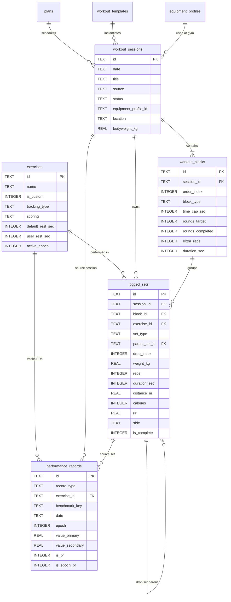

# ADR-033 — Capacitor Android shell and in-app logger first, native Kotlin later

**Status:** ACCEPTED
**Date:** 2026-11-24
**Supersedes:** ADR-031
**Refines:** ADR-001, ADR-004, ADR-011
**Related:** ADR-002, ADR-003, ADR-023, #83

---

## Decision

> Fitness Trainer transitions from a FitNotes-dependent planner to a
> standalone workout planner, catalog browser, and logger. Phase 1 ships as an
> Android `.apk` via **Capacitor** wrapping the existing Vite/JS app, with
> **native Kotlin + Jetpack Compose** as the Phase 2 end goal once workflows
> stabilize.

Four rules govern this transition:

1. **App owns the workout log (supersedes ADR-031).** Completed sets, timed
   efforts, and workout notes are recorded in-app. FitNotes `.fitnotes` / CSV
   support remains available as a one-time history importer and optional backup
   format, not an ongoing runtime dependency.
2. **Capacitor first (`android/`), desktop dev preserved.** The Vite web app
   remains the primary feature lab so development, browser testing on macOS,
   and GitHub Pages continue without emulator overhead. Capacitor packages
   `dist/` into an Android `.apk` with native plugins for permanent local
   storage and background rest timers.
3. **Clean SQLite storage schema (ADR-011).** Performed sets and `ExerciseMax`
   history are persisted in a structured local SQLite database with one-tap /
   automatic local file backup so real training data is never lost to browser
   cache eviction and can transfer directly to Room in Phase 2.
4. **Native Kotlin as Phase 2 end goal.** Once the Catalog, Logger, and core
   progression milestones stabilize in real gym training, a native Kotlin +
   Jetpack Compose client replaces the WebView shell to unlock native memory
   efficiency, Glance home-screen widgets, and lock-screen timer controls,
   sharing `data/` as the source of truth and `js/engine/` outputs as golden
   test fixtures.

---

## Context

Syncing planned workouts into FitNotes via `.fitnotes` SQLite injection
exposed ongoing 3rd-party coupling friction: dynamic `Category` IDs, `(Time)`
companion exercise naming, `exercise_type_id` constraints, and manual file
round-trips. Owning the logger removes that translation layer and lets M8/M8.5
progression read directly from live training history.

Three platform paths were evaluated:

- **Pure Kotlin + Jetpack Compose immediately:** Best Android snappiness,
  battery efficiency, and native widgets/lock-screen controls, but requires
  porting `js/engine/` and rebuilding the planner UI before shipping any new
  logger features, and slows down macOS desktop iteration.
- **Pure browser PWA indefinitely:** Zero native build setup, but browser
  IndexedDB lacks strong permanence guarantees and background lock-screen rest
  timers are unreliable on Android.
- **Vite + Capacitor first, Kotlin later (chosen):** Ships the Catalog and
  Logger rapidly using the existing 325-test JS codebase and `npm run dev`
  browser workflow, adds permanent native SQLite/file backups on Android now,
  and defers the Kotlin/Compose rewrite until the UX and data model are proven
  in the gym.

---

## Consequences

**Positive**

- Zero rewrite of `js/engine/`, `data/`, or the existing test suite to ship a
  complete Android planner + logger `.apk`.
- Fast macOS desktop browser iteration and GitHub Pages remain intact.
- Eliminates 3rd-party FitNotes schema fragility while preserving historical
  data import.
- Clean SQLite schema and `data/` separation keep the future Kotlin + Room
  migration straightforward.

**Negative / accepted**

- WebView carries higher baseline memory and cold-start overhead than native
  Compose during Phase 1, and WebView keyboard/viewport ergonomics require
  explicit CSS/Android configuration.
- UI screens built in HTML/CSS during Phase 1 will be rewritten in Jetpack
  Compose during Phase 2.

**Review condition**

Revisit for Phase 2 (Kotlin + Jetpack Compose) once the in-app Logger,
browsable Catalog (#83), and M8 progression milestones have been used in
real training and the data/UX model is stable.

---

## Standalone SQLite Schema Reference (`js/storage/app-db.js`)

All weights are stored in canonical kilograms (`weight_kg`) and distances in
canonical meters (`distance_m`).

### Key Schema Design Rules

- **Multi-block workouts:** Each `workout_sessions` row owns ordered
  `workout_blocks` (`straight`, `superset`, `circuit`, `emom`, `amrap`,
  `for_time`, `tabata`), so supersets/antagonist supersets only group the
  exercises in that block and auto-advance round by round.
- **Drop sets:** `logged_sets.parent_set_id` and `drop_index` link drop
  stages directly to the parent working set.
- **Soft resets via `epoch`:** Recording per-session bests in
  `performance_records` with `epoch` + `exercises.active_epoch` allows
  non-destructive training-max resets after time off without erasing lifetime
  PRs (`is_pr`).
- **Supporting tables:** `plans`, `workout_templates`, `equipment_profiles`,
  `body_metrics`, `meal_logs`, `meal_presets`, `user_settings`, and
  `schema_migrations` (`APP_SCHEMA_VERSION = 1`).
